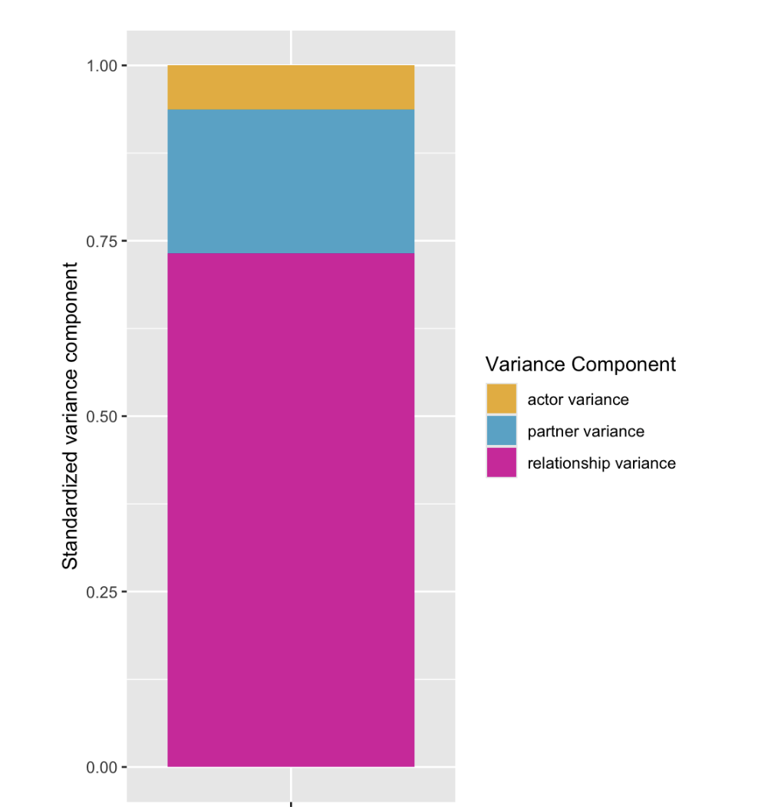
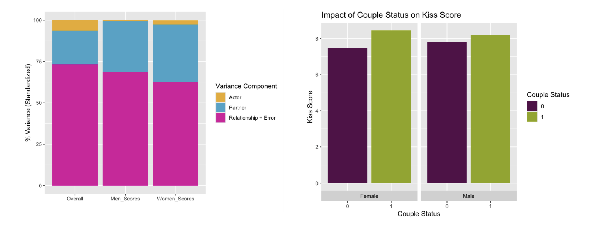
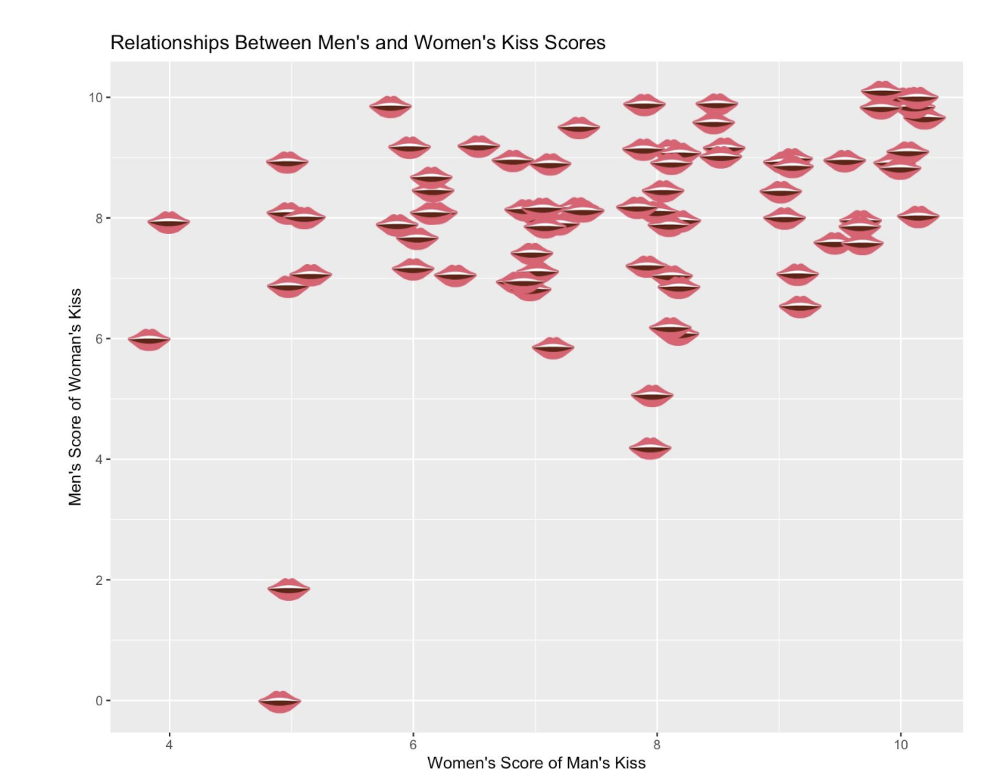

## Context, Please

### What is Love Island?

Love Island is a  television show that started in the UK and now also has versions in the US and in Malta. Across all versions of the show, the basic premise is that 10-12 extremely hot people (5-6 men and 5-6 women) get put into a villa, where their goal is to form couples. Throughout each season, they go through various challenges and games, and then every week or so, the producers force them to “recouple” and dump some people from the villa. As people leave the villa, more hot people are brought in to mix up the existing couples, who are referred to as “bombshells”. At the end of the season, which lasts for 6-8 weeks, the public votes one of the lasting couples as the winner.

### What is the Kissing Challenge?

One infamous challenge on Love Island is the Kissing Challenge (also called Kissing Booth), which has been used on multiple seasons of every iteration of the show. In this challenge, either all of the men or all of the women (the Kissees) line up in blindfolds and headphones. The other gender (the Kissers) goes down the line one by one, kissing all of the Kissees, who subsequently score them out of 10. The contestants (or more likely, the producers helping execute the challenge) then tally up all the scores, and the Kisser with the highest score is crowned the winner. The only prize is bragging rights. On most seasons, the Kissing Challenge is only run in one direction (i.e., only the men or only the women get to be the Kissers), but on two seasons of Love Island USA, the contestants switch after completing one round, so that ultimately, there is a winning man and a winning woman. In this case, we also get scores for each woman kissing each man, as well as for each man kissing each woman. 


## Behind the Scenes

### Data source

Luckily, there are incredible people contributing to the Love Island ITV Wiki, who have already gone through the trouble of entering all of the data from the Kissing Challenge, so I could pretty easily compile it from each respective season of the challenge. Because only seasons USA 4 and 6 had truly reciprocal data, I ultimately only ended up using data from those seasons. 

### Setting up the data

To set up the data, I created a long version of the wiki data, so that each row represented one kiss interaction, with variables for the Season, the Kissee, their gender, the Kisser, the score they received, and a manually coded variable of whether those two individuals were ever in a couple throughout that season. I also created various dummy and contrast codes, and transformed group and individual IDs as needed to prepare for analyses, following pretty similar processes to Kluger et al. (2025).

## Analysis

### What is the social relations model?

To explore this data, I used the social relations model, which conceptualizes dyadic interaction measures as containing actor, partner, relationship, and error variances and partitions these. In this case, dyadic simply refers to the fact that two people are involved in the interaction. Applied to this data, the actor effect describes the variance explained by systematic differences between Kissees. The partner effect describes the variance explained by systematic differences between the Kissers. The relationship effect would describe the “special spark” between certain individuals, but because there weren’t repeated measures taken (i.e., each Kisser only kissed each Kissee once), it isn’t possible to separate this effect from the error term. There are several ways to estimate social relations model parameters, which partially depend on how we treat the design of this “experiment”:

The first way I analyzed the data was to treat it as a round robin event, where individuals were simply cycling through each other giving kisses and ratings. This approach assumes there is no impact of gender or of which season the data is coming from. The advantage to this is that I could use the `TripleR` package (Schönbrodt et al., 2012), which uses the method of moments to estimate all the variances as well as covariances between actor and partner effects.

```{r}
#| eval: false
RR1 <- RR(kiss_score~actorID*partnerID, data=li_ab_data, na.rm=TRUE)
```

Both partner and actor effects were significant. 21% of the variance in scores is driven by the Kisser, and only 6% of the variance in scores is driven by the Kissee. 73.2% of the variance in scores is explained by the combination of relationship effect and error. 



Despite being able to analyze the data as a pure round robin, it’s more appropriate to characterize these interactions as an asymmetric block design, which refers to dyadic interactions where individuals fall into two groups (in this case, men and women). In an asymmetric block design, individuals interact only with those who are not in their in-group (in this case, men only kissing women, and women only kissing men). Kluger et al. (2025) provide an excellent tutorial on completing analyses on this type of data, essentially using a mixed-effects model where actor and partner exist as random effects, and fixed effects like gender, season, and couple status can be included as needed.

```{r}
#| eval: false
mod <- glmmTMB(kiss_score ~1+mwVwm*ever_couple+gID+
                us(0+mw+wm|gID:mID)
                +us(0+wm+mw|gID:wID)
                +us(0+mw+wm|gID:mID:wID), 
                data=li_ab_data, 
                family=gaussian(link="identity"),
                dispformula=~0,
                REML=TRUE,
                verbose=FALSE,
                na.action=na.omit,
                control=glmmTMBControl(
                  optimizer=optim,
                  optArgs = list(method="BFGS"),
                  parallel = parallel::detectCores()))
```

There was no significant effect of men vs women being the Kisser (or Kissee), nor was there a significant effect of season, suggesting that men and women across seasons all rate kisses similarly on average. For men, the effect of partner (Kisser) accounted for 28% of the variance, and for women, this effect accounted for 31%. In this model, for both genders, the Kissee accounted for less than 1% of the variance. Results were broadly similar when I included couple status as a fixed effect, with the addition that being in a couple was associated with scoring approximately 0.75 points higher. Though there wasn’t a significant interaction between gender and couple status, the visual below of this fixed effect hints that women may be more impacted by couple status than men are.



I also played around with widening the data so that each row corresponded to a dyad (one man and one woman), with scores for both the instance when the man was the Kisser and when the woman was the Kisser. This let me play around with the extent to which scores were related to each other via correlation, which is conceptually similar to the concept of dyadic reciprocity in the social relations model. This can also be estimated using Kluger et al. (2025)’s approach, but it was easier to visualize by manipulating the data, so I did it anyway! Across models and a simple correlation, men and women’s scores were moderately correlated.

As a side side project, I decided it was critical to plot this wider data with emojis instead of standard data plots. This was surprisingly easy using the emoGG package, and allowed me to create this incredibly on-theme. 



Using a similar plot, we can also see that couples overall tended to score each other higher. Unfortunately, I couldn’t figure out how to make create a plot with different emojis as the couple status indicators at this time, so we return to standard color indicators.

## Conclusion

It seems like despite all the messiness that comes with Love Island, the Kissing Challenge is actually relatively good at measuring what it purports to measure: the kissing ability of the Kisser! Another way to think about the significant partner effects is that the Kisser is deciding to send a certain message to the Kissee, and the results show that the Kissees’ scores reflect the variety of those messages. These results also suggest that, indeed, people who are in couples with each other tend to enjoy kissing each other more. There are tons of other ways one could analyze this data, and even more if the producers would find ways to get us more truly reciprocal data!
