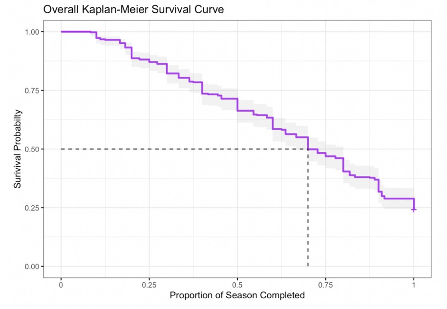
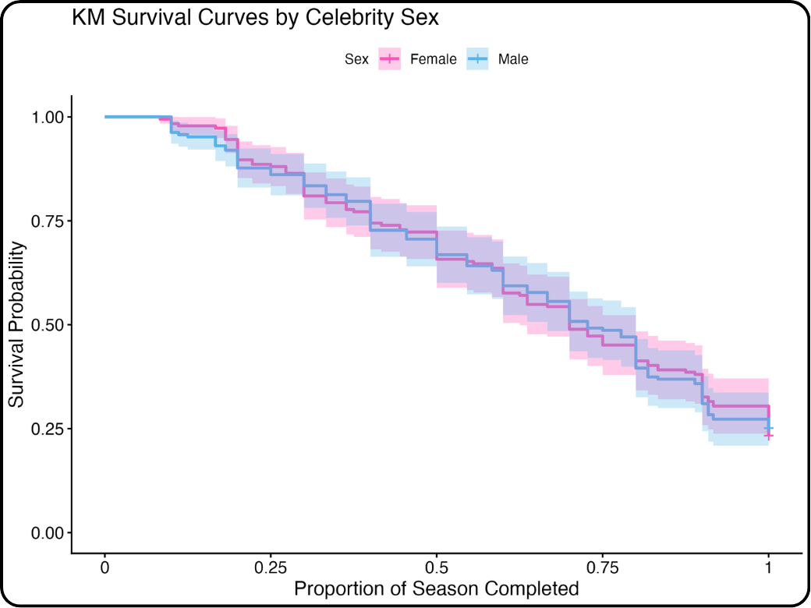
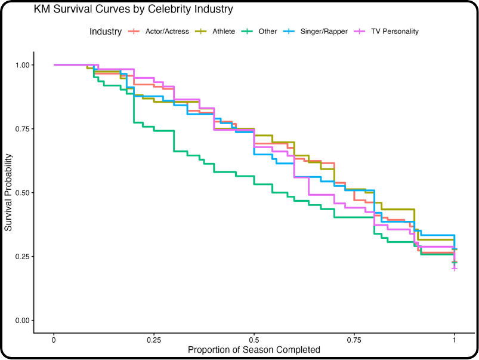

## Context, Please

### What is Dancing with the Stars?

Dancing with the Stars (DWTS) is a reality competition show where 11-14 celebrities are each paired with a professional ballroom dancer. Every week, the pairs perform a dance (Cha-Cha, Tango, Waltz, Samba, Foxtrot, and so on), get scored by a panel of judges, and face a combination of judge scores and fan votes that decides who goes home. A season runs about 7-10 weeks, with one to three couples eliminated each week, until a handful of finalists remain in the last week to compete for the Mirrorball Trophy. 

### Why survival analysis?

A DWTS season is the perfect set-up for a survival analysis. Everyone starts at the same time, people get eliminated (the event) along the way, and the contestants who make it to the finale never experience elimination (censored). That makes it a natural fit for survival analysis, which is built for exactly this kind of time-to-event data. This project started as our final project for STA 379 (Survival Analysis) at Wake Forest, and it asks two questions: which celebrity characteristics are related to how long a contestant lasts in a DWTS season, and how well can those characteristics predict who goes home?


## Behind the Scenes

### Data Source

To answer these questions, we used a Dancing with the Stars dataset from Kaggle that includes our covariates of interest (gender, celebrity industry, week one average judge score, age) and the week they were eliminated. The dataset didn't originally include celebrity gender, so we used Claude to add that column before analysis, and verified its accuracy.

We excluded Season 15, an all-star season of returning contestants, and Season 26, a shortened season made up entirely of athletes, which were both atypical seasons in term of celebrity makeup. That left us with a final sample of 371 contestants.


### Survival Set Up

The trickiest part of the setup was deciding what "time" means. Seasons have different numbers of weeks, so being eliminated in week 5 means something very different in an 8-week season than in a 10-week one. Instead of raw weeks, we used the **percent of the season completed** at elimination as our time variable. Below, we define key criteria for the survival analysis setup.

- Event: Elimination from competition
- Time (perc_season): percent of season completed (season lengths varied)
- Event indicator (Δ):
   Δ = 1 = eliminated (Contestants who were eliminated before the final week.)
   Δ = 0 = censored (Contestants who made it to the final week and placed - 1st,2nd,3rd,etc.) 

This left us with an event rate of 78.9%. 


### Covariates

We looked at four covariates: two categorical (celebrity gender and celebrity industry) and two numeric (celebrity age during the season and their average judge score in week 1, which we used as a measure of baseline dance ability). Industry had a lot of small categories, so we collapsed it into Actor/Actress (n = 117), Athlete (n = 76), TV Personality (n = 59), Singer/Rapper (n = 57), and Other (n = 62), which lumped together everyone else.


### Packages

The analysis relies on `dplyr` for data wrangling, `survival` for fitting Kaplan-Meier curves, log-rank tests, and Cox models, `survminer` for plotting survival curves, and `knitr` for tables. For the prediction piece, we used `hdmetrics`, which isn't on CRAN and can be installed from GitHub:

```{r}
#| label: setup
#| eval: false
pak::pak("sarahlotspeich/hdmetrics/hdmetrics")

library(dplyr)
library(survival)
library(survminer)
library(knitr)
library(hdmetrics)
```


## Analysis

### Overall survival

To start, we fit a Kaplan-Meier curve for all contestants. 

```{r}
#| label: km-overall
#| eval: false
km_overall <- survfit(Surv(perc_season, event) ~ 1, 
                      data = dwts_data, conf.type = "log-log")

ggsurvplot(km_overall, data = dwts_data,
           conf.int = TRUE, surv.median.line = "hv",
           xlab = "Proportion of Season Completed",
           ylab = "Survival Probability",
           palette = "purple", ggtheme = theme_bw())
```

{#fig-overall}

Of our 371 contestants, 281 were eliminated and the rest made it to the finale. As @fig-overall shows, the curve drops steadily across the season, which makes sense: with eliminations every week, everyone's risk of going home accumulates over time. The median survival time was 0.70 (95% CI: 0.67 to 0.80), meaning that by 70% of the way through a season, half the contestants have been sent home.

### Categorical Covariates: Does gender or industry matter?

Next, we compared survival across groups using Kaplan-Meier curves and log-rank tests. For celebrity gender, the curves for men and women are practically on top of each other (@fig-sex).

```{r}
#| label: km-sex
#| eval: false
fit_sex <- survfit(Surv(perc_season, event) ~ celebrity_sex, 
                   data = dwts_data, conf.type = "plain")

logrank_sex <- survdiff(Surv(perc_season, event) ~ celebrity_sex, 
                        data = dwts_data, rho = 0)
```

{#fig-sex}

Industry was more interesting to look at. In @fig-industry, the "Other" category drops off noticeably earlier than everyone else, losing about a quarter of its contestants within the first 20% of the season. Actors, athletes, singers, and TV personalities all track pretty closely together. This tracks with our hypothesis that contestants who have experience performing in the public eye, which are all characteristics actors,  athletes, singers and TV personalities share, may last longer in the DWTS season.

```{r}
#| label: km-industry
#| eval: false
fit_industry <- survfit(Surv(perc_season, event) ~ celebrity_industry, 
                        data = dwts_data, conf.type = "plain")

logrank_industry <- survdiff(Surv(perc_season, event) ~ celebrity_industry, 
                             data = dwts_data, rho = 0)
```

{#fig-industry}

However, neither difference held up statistically. The log-rank tests failed to reject the null hypothesis for both covariates, so we can't conclude that gender or industry is related to time to elimination. 

| Variable | Chi-Square | P-value |
|---|---|---|
| Celebrity Gender | 0.014 | 0.906 |
| Celebrity Industry | 2.989 | 0.560 |

: Log-rank test results for the categorical covariates.

### Numeric Covariates: Does age and week 1 scores matter?

For our numeric covariates, we fit a separate Cox proportional hazards model for each one and checked the proportional hazards assumption with `cox.zph()`.

```{r}
#| label: cox-models
#| eval: false
cox_age   <- coxph(Surv(perc_season, event) ~ celebrity_age_during_season, 
                   data = dwts_data)
cox_score <- coxph(Surv(perc_season, event) ~ week1_avg_judge_score, 
                   data = dwts_data)

cox.zph(cox_age)
cox.zph(cox_score)
```

Both turned out to be strong predictors (p < 0.001 for each).

| Covariate | Log HR | 95% CI | Hazard Ratio |
|---|---|---|---|
| Age (per year) | 0.035 | (0.027, 0.043) | 1.04 |
| Week 1 score (per point) | -0.484 | (-0.579, -0.389) | 0.62 |

: Cox proportional hazards model results for the numeric covariates.

**Age:** Each additional year of age increases the hazard of elimination by about 3.6%. That adds up quickly. Comparing a 59-year-old contestant to a 25-year-old one, the model puts the older contestant's hazard of elimination at roughly 3.3 times higher.

**Week 1 score:** Each additional point in a contestant's week 1 average judge score multiplies their hazard of elimination by about 0.62. In plain terms, a strong first week is a very good sign.

The proportional hazards check told a more nuanced story. Age passed comfortably (p = 0.79), meaning its effect is roughly constant across the whole season. Week 1 score did not (p = 0.005), meaning its effect changes over time. Our hunch is that a great first performance matters a lot early on but fades as the season goes on and contestants improve (or don't).

### Side Quest: Can we predict who goes home?

Finally, we fit a Cox model with all four covariates and asked how well it could tell contestants apart over the course of a season. We used `km_auroc()` from `hdmetrics` to estimate the time-dependent area under the ROC curve (AUC) at 25%, 50%, and 75% of the way through the season.

```{r}
#| label: auc
#| eval: false
cox_full <- coxph(Surv(perc_season, event) ~ week1_avg_judge_score +
                    celebrity_age_during_season + celebrity_sex + 
                    celebrity_industry,
                  data = dwts_data)

dwts_data$betaZ <- cox_full$linear.predictors

km_auroc(evaluate_at = c(0.25, 0.50, 0.75),
         time = "perc_season", event = "event",
         log_risk = "betaZ", data = dwts_data)
```

An AUC of 1 means perfect discrimination and 0.5 is a coin flip. If you pick two contestants at a given point in the season, one who has already been eliminated and one who hasn't, the AUC is the probability that the model assigned the higher risk to the one who went home.

| Percent of season complete | AUC |
|---|---|
| 25% | 0.767 |
| 50% | 0.700 |
| 75% | 0.633 |

: Time-dependent AUC for the full Cox model.

The model does a decent job early on but drifts toward a coin flip as the season goes on. That lines up with the proportional hazards result above: almost all of our covariates are measured at the start of the season, and the biggest predictor, the week 1 score, says less and less about who survives as the weeks go by.

## Conclusion

So who survives the ballroom? Based on our analysis, it's not about whether you're a man or a woman or what made you famous. It's about being younger and walking in with some baseline dance ability. Age and week 1 score were both strong predictors of how long a celebrity lasts, while gender and industry showed no significant relationship with elimination.One thing we wish we had access to with the Kaggle dataset was some measure of a contestants popularity with America, like average votes across their time on the season. Even though judges score are important in remaining on the season, fan base is a very important factor, too (example: king Guillermo!!!!). This project was an engaging way to apply our coursework from our survival course with Dr. Sarah Lotspiech in a fun and meaningful way. We are excited to see who will bring home this season's mirrorball (we're rooting for Ezra or Maura!!!).